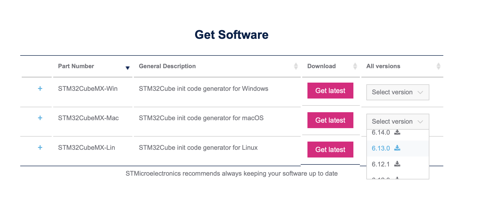
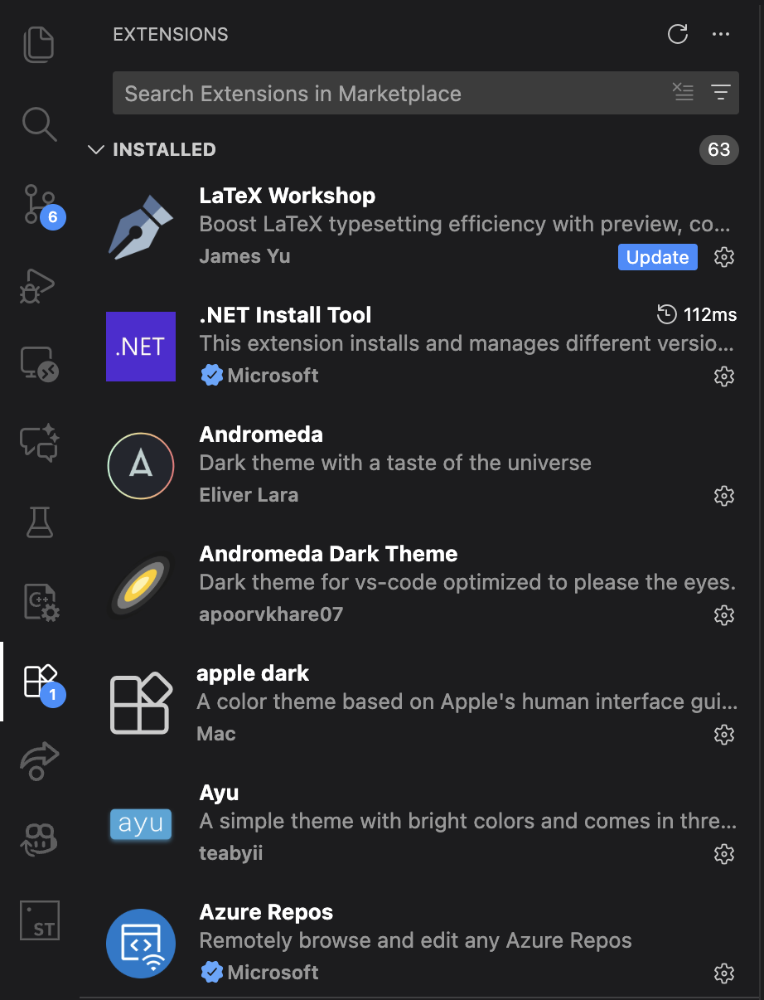
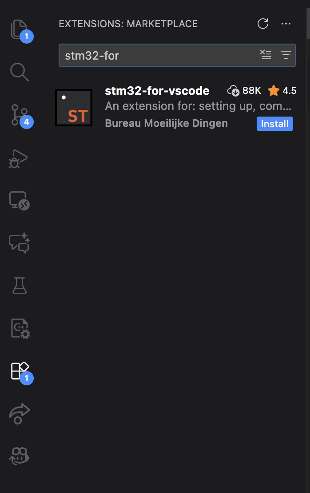
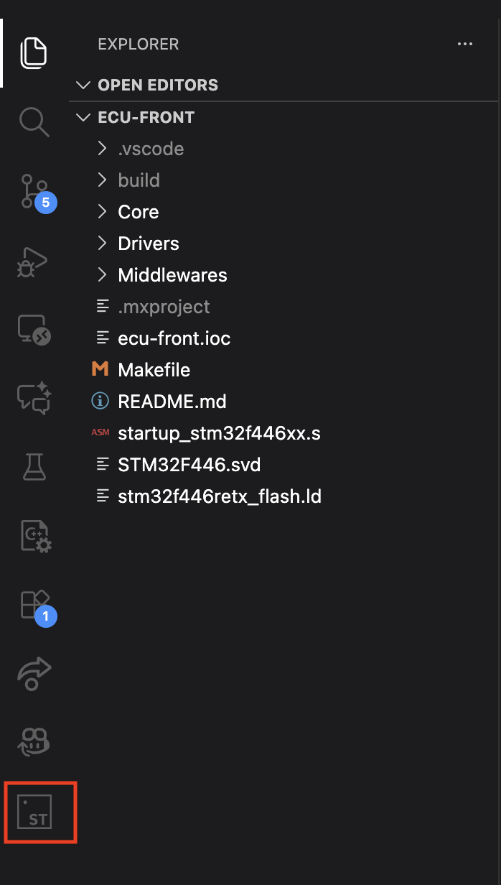
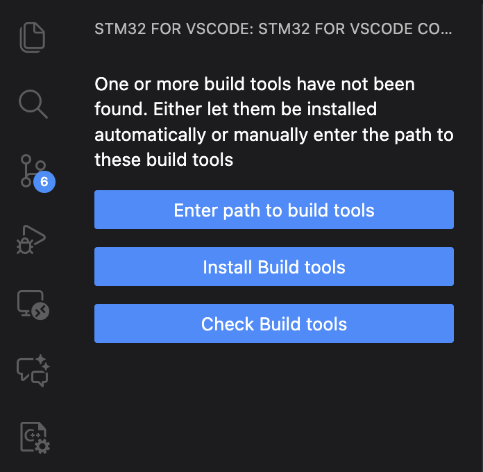
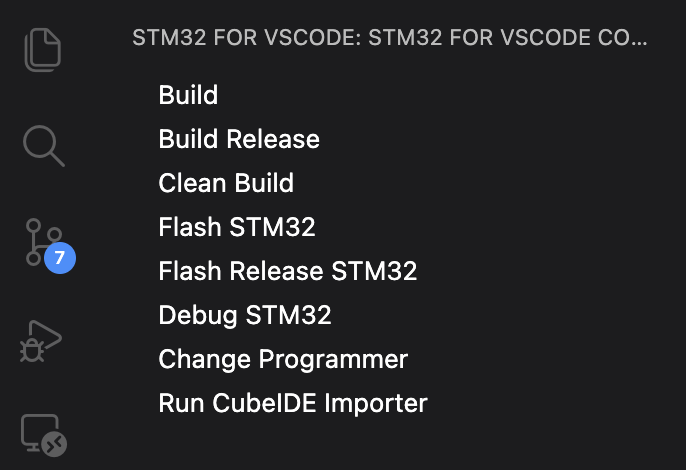

# Nittany Motorsports Electronics

Welcome to the Nittany Motorsports Electronics repository! This repository encapsulates all the software used and developed by the NMS Electronics team.

## Table of Contents

- [Introduction](#introduction)
- [Folder Structure](#folder-structure)
- [Installing Git and Cloning the Repo](#installing-git-and-cloning-the-repo)
- [Installing STM32 Development Environment](#installing-stm32-development-environment)
- [Building and Flashing STM32 Firmware through Manually Installed Buildtools](#building-and-flashing-stm32-firmware-through-manually-installed-buildtools)
- [Debugging an STM32 with OpenOCD & GDB](#debugging-an-stm32-with-openocd--gdb)
- [Debugging an STM32 with Cortex-Debug](#debugging-an-stm32-with-cortex-debug)
- [Contributing](#contributing)
- [License](#license)

## Introduction

This repository serves as the central hub for managing our codebases. We centralized everything into one monorepo to allow easy access to all the software developed and used by the team.

## Folder Structure

- `/components`: All software components in the vehicle
- `/shared`: Resources that can be shared by multiple projects (i.e. a library)
- `/testbench`: All the information, code, and documentation related to our testing environments (HIL and SIL)
- `/tools`: Internal tools and applications used to facilitate processes 

## Installing Git and Cloning the Repo

Every individual project will have a specific guide on how to install all the resources related to the project. However, here is a guide on how to install and use github to contribute to the projects.

Here’s a detailed step-by-step guide on how to install Git on Windows and macOS, followed by instructions on how to clone a GitHub repository using HTTPS.

---

### 1. Installing Git on Windows

#### Step 1: Download Git
1. Visit the Git official download page: [Git for Windows](https://git-scm.com/download/win).
2. The download should start automatically. If not, click the appropriate link to manually start it.

#### Step 2: Install Git
1. Once the download is complete, double-click the `.exe` file to begin the installation process.
2. Follow the installation wizard:
   - Accept the default options unless you have specific preferences.
   - Make sure **Git Bash** and **Git GUI** are selected.
   - Optionally, you can add Git to your system's PATH if prompted (recommended).

#### Step 3: Verify Installation
1. After the installation is finished, open **Git Bash** or **Command Prompt**.
2. Run the following command to confirm that Git is installed:
   ```bash
   git --version
   ```

---

### 2. Installing Git on macOS

#### Step 1: Download and Install Git
1. Open **Terminal** (you can find it in `Applications > Utilities`).
2. Run the following command to check if Git is already installed:
   ```bash
   git --version
   ```
   - If Git is not installed, you will be prompted to install the **Xcode Command Line Tools**, which includes Git.
   - Follow the on-screen instructions to install the Command Line Tools.

#### Step 2: Install Git via Homebrew (Optional)
If you prefer to install Git using **Homebrew** (a package manager for macOS):
1. First, install Homebrew (if you don’t have it installed) by running:
   ```bash
   /bin/bash -c "$(curl -fsSL https://raw.githubusercontent.com/Homebrew/install/HEAD/install.sh)"
   ```
2. Once Homebrew is installed, run the following command to install Git:
   ```bash
   brew install git
   ```

#### Step 3: Verify Installation
1. After Git is installed, check the version to confirm:
   ```bash
   git --version
   ```

---

### 3. Cloning a GitHub Repository Using HTTPS

Once Git is installed, follow these steps to clone a GitHub repository using HTTPS.

#### Step 1: Open Terminal or Git Bash
- **Windows:** Open **Git Bash** or **Command Prompt**.
- **macOS:** Open **Terminal**.

#### Step 2: Navigate to Your Desired Directory
Use the `cd` command to navigate to the directory where you want to clone the repository:
```bash
cd /path/to/your/directory
```

#### Step 3: Clone the Repository
Follow this GitHub [guide](https://docs.github.com/en/repositories/creating-and-managing-repositories/cloning-a-repository?platform=mac&tool=webui) to clone the repository.

#### Step 4: Navigate into the Cloned Repository
After cloning, navigate to the repository's directory:
```bash
cd repository-name
```

### 4. Install Pre-Commit

We use [pre-commit](https://pre-commit.com/) to automatically enforce style checks. Follow these instructions to install pre-commit.

#### Step 1: Install pre-commit

Use pip to install pre-commit:
```bash
pip install pre-commit
```

#### Step 2: Register the pre-commit hooks

Now we need to tell git to run our commands on every commit. To do that run this command:
```bash
pre-commit install
```

Now, the formatters will run on every commit.

---

Following these steps will allow you to install Git on both Windows and macOS, and easily clone a repository using HTTPS.

***PLEASE TAKE A LOOK AT [GITHUB DEV GUIDE](/git-cheatsheet.pdf) TO UNDERSTAND HOW TO MANAGE THE REPO***

## Installing STM32 Development Environment

The Electronics team uses STM32 microcontrollers for all the microchips included in the vehicle, for exception of an ESP32 uses to update the vehicle software remotely and provide live telemetry (the setup guide for this microcontroller will be included in its project folder `nms/electronics/lv-electronics/megaboard-rear/software/ota-bootloader-host`).

This guide will walk you through the setup process for cloning the repository, setting up your development environment with Visual Studio Code (VSCode), and configuring STM32CubeMX.

### Steps
### Step 1: Setup Git
Follow the instructions under [Installing Git and Cloning the Repo](#installing-git-and-cloning-the-repo)

### Step 2: Download and Install STM32CubeMX
Download STM32CubeMX:
Go to the [STMicroelectronics website](https://www.st.com/en/development-tools/stm32cubemx.html#overview) and download STM32CubeMX `v6.13.0`.


### Step 3: Intall the build and flash tools
#### Step 1: Download `arm-none-eabi`
1. Download `arm-none-eabi` version `13.2.rel1` from the [ARM Developer website](https://developer.arm.com/downloads/-/arm-gnu-toolchain-downloads):
   - Windows: [`arm-gnu-toolchain-13.2.rel1-mingw-w64-i686-arm-none-eabi.exe`](https://developer.arm.com/-/media/files/downloads/gnu/13.2.rel1/binrel/arm-gnu-toolchain-13.2.rel1-mingw-w64-i686-arm-none-eabi.exe?rev=07af46c1f7574a77969b0f764a1255f0&revision=07af46c1-f757-4a77-969b-0f764a1255f0&hash=E9A249B67D1665FD76FA759D8A54A116)
   - Linux (x86_64): [`arm-gnu-toolchain-13.2.rel1-x86_64-arm-none-eabi.tar.xz`](https://developer.arm.com/-/media/files/downloads/gnu/13.2.rel1/binrel/arm-gnu-toolchain-13.2.rel1-x86_64-arm-none-eabi.tar.xz?rev=e434b9ea4afc4ed7998329566b764309&revision=e434b9ea-4afc-4ed7-9983-29566b764309&hash=B7747CCEEAC7C32A13B823A6AAF1CC2E) 
   - Linux (Aarch64): [`arm-gnu-toolchain-13.2.rel1-aarch64-arm-none-eabi.tar.xz`](https://developer.arm.com/-/media/files/downloads/gnu/13.2.rel1/binrel/arm-gnu-toolchain-13.2.rel1-aarch64-arm-none-eabi.tar.xz?rev=17baf091942042768d55c9a304610954&revision=17baf091-9420-4276-8d55-c9a304610954&hash=23971B60EBD489CD3F7C119BD96D1074)
   - macOS (x86_64): [`arm-gnu-toolchain-13.2.rel1-darwin-x86_64-arm-none-eabi.pkg`](https://developer.arm.com/-/media/files/downloads/gnu/13.2.rel1/binrel/arm-gnu-toolchain-13.2.rel1-darwin-x86_64-arm-none-eabi.pkg?rev=cececaabca0446dfaf450d0e7d4f6c8c&revision=cececaab-ca04-46df-af45-0d0e7d4f6c8c&hash=0D501063D9B29461A66547C730D0B0A9)
   - macOS (Apple silicon): [`arm-gnu-toolchain-13.2.rel1-darwin-arm64-arm-none-eabi.pkg`](https://developer.arm.com/-/media/files/downloads/gnu/13.2.rel1/binrel/arm-gnu-toolchain-13.2.rel1-darwin-arm64-arm-none-eabi.pkg?rev=1c09b63d0475408c9cf8a59783f4e470&revision=1c09b63d-0475-408c-9cf8-a59783f4e470&hash=AE05464A1AB31D0AE4E5D1D170AA5AF7)

2. Add the folder `/ArmGNUToolchain/13.2.Rel1/arm-none-eabi/bin` to `PATH`. To add the folder to path you can follow the directions at this [link](https://gist.github.com/janAkali/338e6bf143fcd0161a2f0d768b938e4b) based on your platform. 

   **Note:** on Windows the path will likely be `\Arm GNU Toolchain\13.2.Rel1\bin`, but the installer prompts to add the folder to PATH automatically, so you may skip this step.

   > ⚠️ *IMPORTANT*: adding this folder to `PATH` is extremely important for the success of all the steps that come after this. If you are struggling to add the `bin/` folder to `PATH`, AI models like ChatGPT can also be very helpful.

3. Verify that `arm-none-eabi` was successfully downloaded and added to `PATH` by running:
   ```
   arm-none-eabi-gcc --version
   ```
   This command should return the correct version of `arm-none-eabi` downloaded. 
   
   Example:
   ```
   jdiprato@Jacopos-MacBook-Air ~ % arm-none-eabi-gcc --version
   arm-none-eabi-gcc (Arm GNU Toolchain 13.2.rel1 (Build arm-13.7)) 13.2.1 20231009
   Copyright (C) 2023 Free Software Foundation, Inc.
   This is free software; see the source for copying conditions.  There is NO
   warranty; not even for MERCHANTABILITY or FITNESS FOR A PARTICULAR PURPOSE.
   ```

#### Step 2: Download the remaining of the build and flash tools

At this point, there are two main options to install build and flash tools:
1. [Standalone Build Tools](#installing-standalone-build-tools) allow you to build and flash firmware by using terminal commands, freeing you from any text editor dependencies.
2. [stm32-for-vscode](#installing-stm32-for-vscode) is a VSCode extension that allows you to build and flash firmware through a UI integrated in VSCode, which is extremely easy for beginners (but forces you to use VSCode).


## Installing Standalone Build Tools

### Tools you will install
- `openocd`
- `make`

### Steps
### Step 1: Download `openocd`

#### Step 1: Download `openocd` on your platform

- Windows

   Download the OpenOCD `.zip` archive from the **xPack** project:

   1.  **Go to the xPack OpenOCD releases page:**
      [github.com/xpack-dev-tools/openocd-xpack/releases](https://github.com/xpack-dev-tools/openocd-xpack/releases)

   2.  Find the latest release (it will have a green "Latest" tag).

   3.  Scroll down to the **"Assets"** section.

   4.  Download the file that ends in **`-win32-x64.zip`**.

   5.  Create a permanent folder for your development tools.
      * **Example:** `C:\Tools\OpenOCD`

   6.  Extract the entire contents of the `.zip` file into the folder you just created.

   > ⚠️ **CRITICAL STEP FOR WINDOWS IF YOUR LAPTOP CANNOT COMMUNICATE TO THE ST-LINK: ST-Link Drivers**
   OpenOCD **cannot** use the default ST-Link drivers. You must replace the driver using a tool called **Zadig**.

   1.  Plug in your ST-Link programmer.
   2.  Download and run **Zadig**: [zadig.akeo.ie](https://zadig.akeo.ie/)
   3.  In Zadig, go to **Options** and check **"List All Devices"**.
   4.  Find your ST-Link in the dropdown menu. (It might appear as "STM32 STLink", "ST-Link Debug", etc.)
   5.  Select it. On the right side, select the driver to install. Choose **WinUSB (v6.x.x.x)**.
   6.  Click the **"Replace Driver"** or "Install Driver" button.

   After this, OpenOCD will be able to find and communicate with your probe.

- macOS

   If you don't have Homebrew, install it first from [brew.sh](https://brew.sh).

   Open a terminal and run:

   ```bash
   brew install openocd
   ```

- Linux

   Open a terminal and run the following commands:

   ```bash
   sudo apt update
   sudo apt install openocd
   ```

#### Step 2: Add `openocd` to `PATH` and Verify Installation

Add `openocd` to `PATH` if necessary. Find the folder where `openocd` is installed (e.g `C:\Tools\OpenOCD\xpack-openocd-0.12.0-7\bin`, `/opt/homebrew/bin`) and add that folder to path you can follow the directions at this [link](https://gist.github.com/janAkali/338e6bf143fcd0161a2f0d768b938e4b) based on your platform.

Verify that `openocd` was successfully downloaded and added to `PATH` by running:
```
openocd --version
```
This command should return the version of `openocd` downloaded.

Example:
```
jdiprato@Jacopos-MacBook-Air ~ % openocd --version
Open On-Chip Debugger 0.12.0
Licensed under GNU GPL v2
For bug reports, read
   http://openocd.org/doc/doxygen/bugs.html
```

### Step 2: Download `make`
1. Download `make` according to your platform:
   - macOS: run the following command in terminal to install the XCode command line tools, which include `make`.
      ```bash
      xcode-select --install
      ```
   - Linux: `make` is almost always pre-installed, but in case it's not, run the following command in terminal to install `build-essential`
      ```bash
      sudo apt install build-essential
      ```
   - Windows: (sorry this is the hardest one `:(` ) Please follow the instructions on this [website](https://leangaurav.medium.com/how-to-setup-install-gnu-make-on-windows-324480f1da69) to install `make` on Windows.
2. Verify that `make` was successfully downloaded and added to `PATH` by running:
   ```
   make --version
   ```
   This command should return the version of `make` downloaded.
   
   Example:
   ```
   jdiprato@Jacopos-MacBook-Air ~ % make --version
   GNU Make 3.81
   Copyright (C) 2006  Free Software Foundation, Inc.
   This is free software; see the source for copying conditions.
   There is NO warranty; not even for MERCHANTABILITY or FITNESS FOR A
   PARTICULAR PURPOSE.

   This program built for i386-apple-darwin11.3.0
   ```

### Step 3: Build a Project!
You have now set up your development environment for working with firmware. Now, test that you can build a firmware project successfully.

Execute the following commands in your terminal:
```bash
cd nms-electronics/components/ecu-front # navigate to the ecu-front project folder

make # build the project and make sure that the build is successful
```
For any issues or questions, please refer to the project's Issues page or contact the project maintainers.


## Installing stm32-for-vscode

### Step 1: Download Visual Studio Code
Download Visual Studio code from this [link](https://code.visualstudio.com/download)

### Step 2: Open the Visual Studio Code Extensions Tab
Open VS Code and open the Extensions tab:



### Step 3: Install stm32-for-vscode
Search for the `stm32-for-vscode` extension and install it



### Step 4: Open an STM32 Project
Find an STM32 project in the repo, for example `nms-electronics/components/ecu-front` and open it in VSCode (BY ITSELF).
You should see an extension icon appear on the left hand size with the `ST` logo.



### Step 5: Install the build tools
Open the stm32-for-vscode extension on the left hand side and it should prompt you to install the build tools (this will not be the case if you already have `arm-none-eabi` and `openocd` already installed and added to `PATH` because the extension will automatically find them).



### Step 6: Build and Flash
If everything was installed correctly, you should see these buttons pop up:



### Bonus Step: Automatically flash bootloader and application
Every ECU has to have a bootloader to properly work. You can either manually flash the bootloader to the STM32 you are using manually by flashing the project in `components/bootloaders/stm32f446re`, or you can modify the stm32-for-vscode extension yaml file to add a custom makefile rule. Add the following lines in the `STM32-for-VSCode.config.yaml` in the individual project folder, right under the `customMakefileRules` section: 
```
- command: flash-bootloader
  rule: $(MAKE) -C ../bootloaders/stm32f446re-bootloader flash

# This flash will override what is in the STM32Make.make
- command: flash
  rule: $(OPENOCD) -f interface/stlink.cfg -f target/stm32f4x.cfg -c "program $(RELEASE_DIRECTORY)/$(TARGET).elf verify reset exit"
  dependsOn: flash-bootloader all
```

Adding these custom makefile rules will allow you to automatically flash the bootloader and the firmware application automatically when you click `Flash STM32`. If you installed the build and flash tools manually, you can also flash the code without needing to do this by running the command `make flash` from the project folder instead of using the extension.

## Building and Flashing STM32 Firmware through Manually Installed Buildtools
Here are the terminal commands you can run from an STM32 project folder to build and flash firmware.

- Build firmare:
   ```
   make
   ```

- Flash firmware to an STM32 (this flashes both bootloader and project):
   ```
   make flash
   ```

- Erase flash memory of the STM32:
   ```
   make flash-erase
   ```

## Debugging an STM32 with OpenOCD & GDB

This guide outlines the standard command-line workflow for flashing and debugging an STM32 microcontroller using OpenOCD and `arm-none-eabi-gdb`.

This workflow uses a client-server model:
* **OpenOCD:** The **server** that runs on your PC and speaks the low-level JTAG/SWD protocol to your debug probe (like an ST-Link).
* **GDB:** The **client** that you interact with. It understands your source code and sends high-level commands (like "set breakpoint") to OpenOCD.

### Step 1: Start OpenOCD (The Server)

First, you must start the OpenOCD server. It will wait for a GDB client to connect.

1.  Open a terminal
3.  Navigate to the path of an STM32 project within this repository (e.g. `nms-electronics/components/ecu-front`)
2.  Run the command `make debug` which starts `openocd` with the right configuration
3.  If successful, you will see output ending with a line like:
    `Info : accepting 'gdb' connection on port 3333`

**Keep this terminal running.**

---

### Step 2: Start GDB (The Client)

Next, start GDB and point it to the `.elf` file that contains your program and its debug symbols.

1.  Open a **second terminal**.
2.  Navigate to the path of an STM32 project within this repository (e.g. `nms-electronics/components/ecu-front`)
3.  Run `arm-none-eabi-gdb` and pass the path to your `.elf` file:

    ```bash
    arm-none-eabi-gdb build/ecu-front.elf
    ```

4.  You will now be at a `(gdb)` prompt.

---

### Step 3: GDB Workflow (Load & Run)

Inside the `(gdb)` prompt, follow these steps to connect, flash, and run your program.

```gdb
# 1. Connect to the OpenOCD server
(gdb) target extended-remote :3333

# 2. Halt the chip and reset it to a known state
(gdb) monitor reset halt

# 3. Load (flash) the program onto the target
#    GDB automatically uses the .elf file you started it with
(gdb) load

# 4. Set a breakpoint at the start of your code
(gdb) break main

# 5. Run the program.
#    The chip will run and stop at your breakpoint.
(gdb) continue
```

## Debugging an STM32 with Cortex-Debug
If you would like a visual interface that interacts with your code for debugging, you can configure Visual Studio Code for visual debugging of STM32 using the **Cortex-Debug** extension and **OpenOCD**.

> **⚠️ IMPORTANT:** These steps need to be followed by having a project folder (e.g. `nms-electronics/components/ecu-front`) open in Visual Studio Code

### Prerequisites

Before configuring VS Code, ensure the following tools are installed and added to your system's `PATH`:

1.  **ARM GCC Toolchain:** (`arm-none-eabi-gcc`, `arm-none-eabi-gdb`)
2.  **OpenOCD:** The GDB Server that connects to the ST-Link.
3.  **VS Code Extensions:**
    * [C/C++](https://marketplace.visualstudio.com/items?itemName=ms-vscode.cpptools) (Microsoft)
    * [Cortex-Debug](https://marketplace.visualstudio.com/items?itemName=marus25.cortex-debug) (marus25)

---

### 1. Get the System View Description (SVD)

> **⚠️ IMPORTANT**: if the project folder you are trying to debug already has a **STM32F446.svd** file, you can ignore this section.

To view peripheral registers (like `GPIOA`, `SPI1`, `CAN1`) in human-readable format rather than raw memory addresses, you need the SVD file for the F446.
1.  Download the **STM32F446.svd** file.
    * *Source:* [ST-Microelectronics SVD Repo](https://github.com/modm-io/cmsis-svd-stm32) or extract it from STM32CubeIDE.
2.  Place the `.svd` file in the root of your project folder (or a `debug/` subdirectory).

### 2. Configure `launch.json`

1.  In VS Code, go to the **Run and Debug** tab (`Ctrl+Shift+D` for Windows, `Command+Shift+D` for macOS).
2.  Click **create a launch.json file** or the gear icon at the top if there is already a `launch.json` file to open the `launch.json` file.
3.  Select **Cortex-Debug** (if prompted).
4.  Paste the following configuration into the file.

> **⚠️ IMPORTANT:** Update the `"executable"` path to match your build output (e.g., `build/firmware.elf`).

```json
{
    "version": "0.2.0",
    "configurations": [
        {
            "name": "Debug STM32F446RE (OpenOCD)",
            "cwd": "${workspaceFolder}",
            "loadFiles": ["${workspaceFolder}/build/your_firmware.elf"],
            "symbolFiles": ["${workspaceFolder}/build/your_firmware.elf"],
            "request": "launch",
            "type": "cortex-debug",
            "servertype": "openocd",
            "device": "STM32F446RE",
            "configFiles": [
                "interface/stlink.cfg",
                "target/stm32f4x.cfg"
            ],
            "svdFile": "${workspaceFolder}/STM32F446.svd",
            "runToEntryPoint": "main",
            "showDevDebugOutput": "none"
        }
    ]
}
```

## Contributing

Please follow these guidelines:

1. Create an Issue in the Issues tab (**please double check if the issue already extists**).
2. Name the issue with a summary of what you are implementing and the project (i.e. CAN Bus Implementation - HV BMS Software, Brake Pressure Reading - Megaboard Front STM Software, SOC Estimation Implementation - LV BMS Software, UART Driver - Megaboard Rear, etc.).
3. Add a description of the issue, describing with as much details as you can what you are working on. Pictures are encouraged for clarity purposes (diagrams, example schematics, etc.).
4. Fill out the Assignee on the top right (yourself if you are creating the issue for yourself, or the name of the person you are assigning the issue to).
5. Add a Label to the issue (bug, feature, etc. based on what you are implementing or fixing)
6. Click on `Submit New Issue` to create the issue.
7. Open the issue and if you scroll down on the right there should be a `Create a branch` blue hyperlink.
8. Click on it to create a branch, leaving the default naming scheme, and branching from `develop`, **not main**.
9. Now you are good to work in your branch!
10. After completing your work, create a well documented pull request to merge your implementation to `develop`.

## License

If we ever establish licensing then list those here.

**Note:** If you add a licensed component to a project, make sure to add the component's license within the project and list it in the License section of the project's readme.

---

**Note:** This README was written by ChatGPT, thanks ChatGPT.

**Note(pt 2):** Thanks Kyle for asking ChatGPT.
