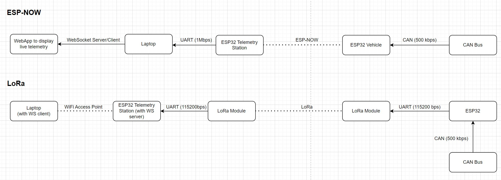

# Nittany Motorsports Telemetry Station

Welcome to the Nittany Motorsports Telemetry Station Project! This repository contains the codebase for the ESP32 that receives live CAN data through the ESP-NOW protocol.

## Table of Contents

- [Introduction](#introduction)
- [Rationale](#rationale)
- [Folder Structure](#folder-structure)
- [Setup and Installation](#setup-and-installation)
- [Contributing](#contributing)
- [License](#license)

## Introduction

The **Telemetry Station** receives CAN data sent by the ESP32 located in the vehicle and transmits it to a laptop connected to it over UART at 1Mbps. This allows to view live data and accurately monitor the current state of the vehicle.

## Rationale

### Requirements
- Cost: the team's budget is not high, and we cannot afford to prototype expensive solutions. The lower the cost, the better, but prototyping and developing a final solution cannot exceed $100.
- Range:  the system needs to be able to cover the track on which the car runs at competition (https://www.fsaeonline.com/app/MapViewer.aspx?mapid=92a22acb-70ae-4ef7-9835-d7912bde0ced). A generous estimate would be that to get data from the vehicle at all times, we would need a range of about ~1000ft, or ~300 meters (if positioned in the middle of the long side on the outside of the track).
- Bandwidth: the vehicle produces about 250kbps of data, and we would like to transmit most of this data reliably. For the moment, it is ok to lose 10-20% of the data.
- Licensing: the team doesn't want the solution to require an FCC license, and we don't want to get in trouble for using unauthorized frequencies/signals.
- Interface. We use an ESP32 to collect all the data from the vehicle, so whatever we use to transmit the data has to be able to interface with the ESP32. The most ideal solution is that the method uses the ESP native wireless communication stacks, or the additional device is able to interface with the ESP32 over the UART communication protocol.

### Options
#### LoRa Modules
LoRa Modules (https://en.wikipedia.org/wiki/LoRa) is a radio communication protocol that operates at low frequencies to allow long range (even several miles). For this solution we would connect one module over UART to the ESP32 located in the vehicle and the other module would be connected to another controller over UART wich would act as a receiving station.
##### Pros
- Excessive long range (way more than what we need)
- UART interface with ESP32 and easy-to-implement AT commands
- Price - cheap, would require additional receiving controller and 2 LoRa transceivers
##### Cons
- Low bandwidth - According to this document about the transceivers we have available (https://reyax.com//upload/products_download/download_file/RYLR998_EN.pdf) the highest bandwidth achieved was 4400bps, which is far lower than our requirement
- Need to develop firmware and hardware for a receiving node

#### WiFi Access Point
The ESP32 in the vehicle already hosts an access point, so to extend the signal we could use a high gain receiving antenna connected to a laptop. The ESP32 located in the vehicle will use a redular 6 dBi omnidirectional antenna.
##### Pros
- No implementation required (system would stay as is)
- Range (not tested but https://www.youtube.com/watch?v=yCLb2eItDyE&ab_channel=Jeija)
##### Cons
- Not practical - A high gain antenna requires someone to constantly point the antenna towards the vehicle as it moves
- Price - High gain antennas are more expensive than the other solutions (especially sector antennas which would be much better for this purpose)

#### ESP-NOW
ESP-NOW (https://docs.espressif.com/projects/esp-idf/en/stable/esp32/api-reference/network/esp_now.html) is a ESP32 only protocol that operates at the 2.4Ghz frequency which leverages the ESP32 WiFi stack. This solution would require 2 ESP32 to communicate using this protocol. One of them is the ESP32 located in the vehicle, while the other one would act as a receiving station. Both nodes would use an omnidirectional 6dBi antenna (https://www.amazon.com/Bingfu-Antenna-Extension-Wireless-Network/dp/B08G585HM6/).
##### Pros
- Range - this protocol can leverage Long Range WiFi mode of ESP32 (https://docs.espressif.com/projects/esp-idf/en/stable/esp32/api-guides/wifi.html). Range is claimed to be ~1km with clear line of sight, but testing resulted in ~300m without a clear line of sight 
- Price - cheap, would only require an additional ESP32 and antenna (one in the vehicle already exists)
- Bandwidth - With LongRange mode enabled the bandwidth is claimed to be 256-512kbps
##### Cons
- Need to develop firmware and hardware for a receiving node

### Conclusion
The ESP-NOW option was chosen because it satisfies all of our requirements (theoretically) and is the cheapest to implement. We will also attempt to support LoRa module communcation in case the range at competition does not satisfy our expectations.

### Diagram 


### Data Transmission Over UART
Once a CAN message is received by the Telemetry Station over ESP-NOW, the message is processed and sent in a modified SLCAN (https://www.canusb.com/products/canusb/) protocol over UART to the laptop connected to the telemetry station. UART0 was chosen as the ESP32 UART port for this transmission as this is the same UART port with wich the micro-USB port interfaces (i.e. no need for an additional USB-to-Serial converter).

The SLCAN protocol was modified to include a timestamp component to be able to accurately transmit the time at which the data was received on the CAN bus, instead of relying on the time at which the data is received by the laptop, which may be inaccurate.

Following is the structure of a frame of the modified SLCAN protocol:
```
t<id><dlc><data...><timestamp>\r
- 't' is the start of the frame
- <id> is a 3-digit hex number (0-7FF)
- <dlc> is a 1-digit hex number (0-8)
- <data> is a 2-digit hex number (0-FF) for each byte of data
- <timestamp> is an 8-digit hex number (0-FFFFFFFF)
- '\r' is the end of the frame

The frame can also be represented as: tiiildd...ssssssss\r (t = start of frame, i = id, l = dlc, d = data, s = timestamp, \r = end of frame)
```


## Folder Structure

- `/components/telemetry`: contains ESP-NOW related tasks and function to receive live data from the vehicle
- `components/util`: contains general utility functions/structs/enums

## Setup and Installation

### `esp-idf-v5.2.5` is not included in this repository

1. Follow the installation instruction in https://github.com/espressif/esp-idf/releases/tag/v5.2.5 to download the zip file

2. Extract `esp-idf-v5.2.5` contents from the downloaded zip file

2. Read the "Setup Build Environment" section in https://github.com/espressif/esp-idf/blob/master/README.md to initialize the ESP_IDF development framework


### `esp-idf-v5.2.5` is included in this repository:
1. Install python on your local machine (https://www.python.org/downloads/)

   To verify python is installed on your machine run `python --version`

2. Run the following commands based on your platform to initialize development framework:

   On Windows Command Prompt:
   ```
   # Installs ESP-IDF locally (will only need to be ran once)
   esp-idf-v5.2.5/install.bat

   # Initialize the ESP-IDF environment (run once for every terminal session)
   esp-idf-v5.2.5/export.bat
   ```

   On Windows Powershell:
   ```
   # Authorize Powershell to run these files (will only need to be ran once)
   Unblock-File esp-idf-v5.2.5/export.ps1

   # Installs ESP-IDF locally (will only need to be ran once)
   esp-idf-v5.2.5/install.bat

   # Initialize the ESP-IDF environment (run once for every terminal session)
   esp-idf-v5.2.5/export.ps1
   ```

   On Unix systems (macOS/Linux) - NOT TESTED YET!:
   ```
   # Installs ESP-IDF locally (will only need to be ran once)
   esp-idf-v5.2.5/install.sh

   # Initialize the ESP-IDF environment (run once for every terminal session)
   esp-idf-v5.2.5/export.sh
   ```
3. Now run `idf.py` commands:
   ```
   # build project
   idf.py build

   # flash project to ESP32 (needs to be connected via USB)
   idf.py flash

   # monitor ESP32 (will display serial output produced by ESP32)
   idf.py monitor
   ```


## Contributing

Please follow these guidelines in `nms-electronics/README.md`

## License

- ESP-IDF License: Apache 2.0 (`LICENSES/ESP-IDF_LICENSE.txt`)

---

**Note:** This README was written by ChatGPT, thanks ChatGPT.
